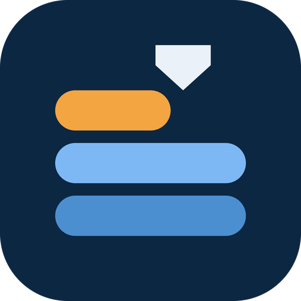
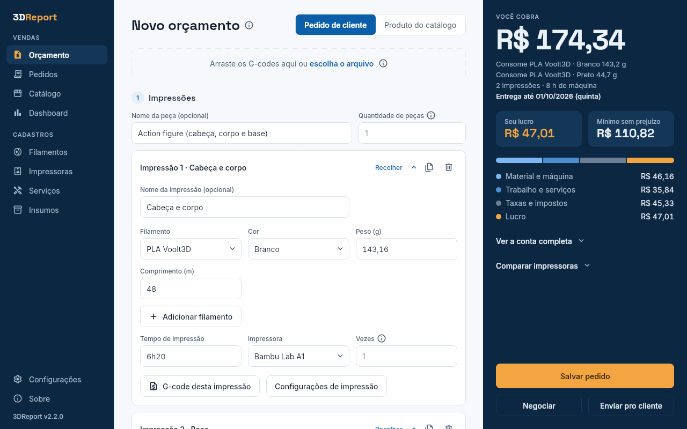
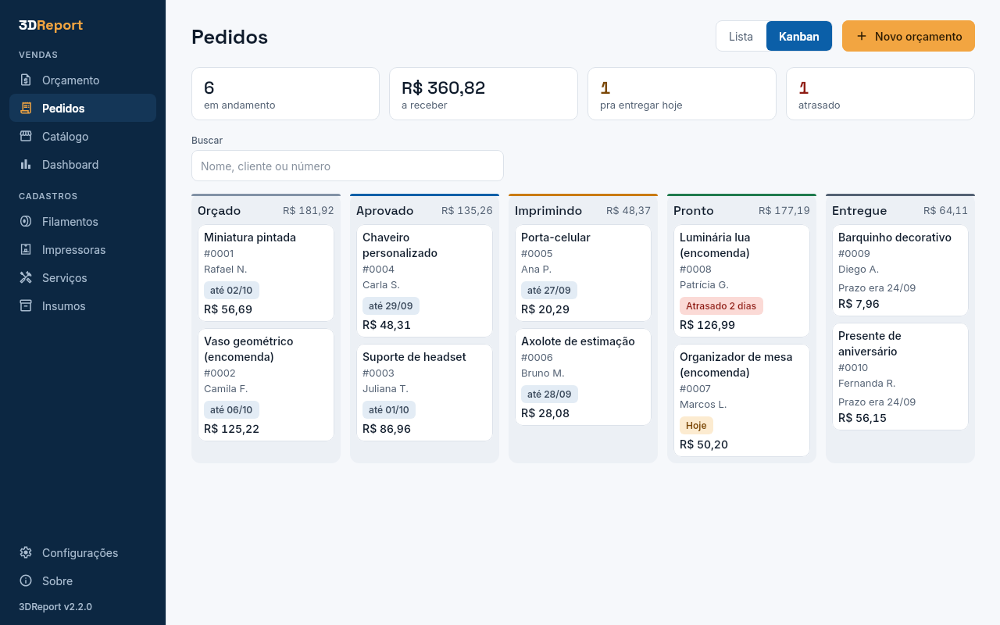
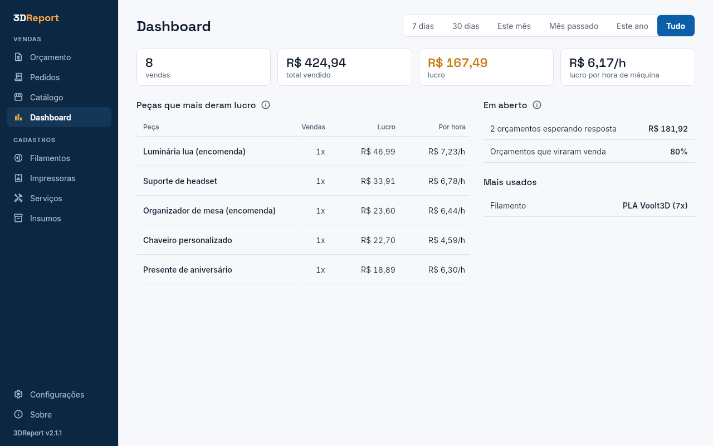
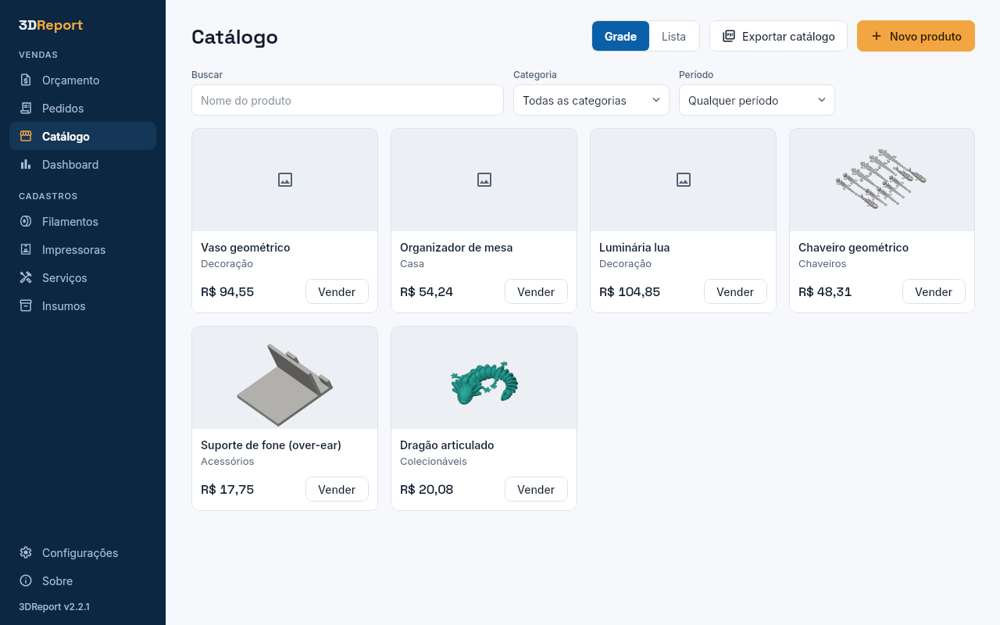
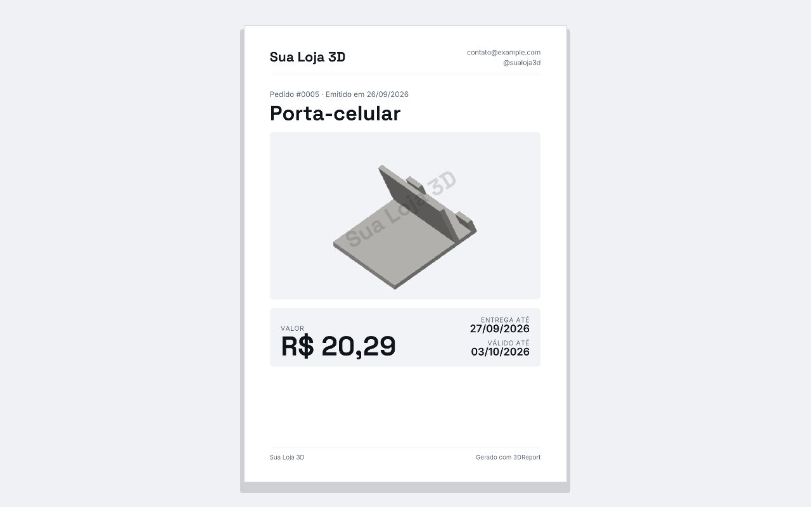
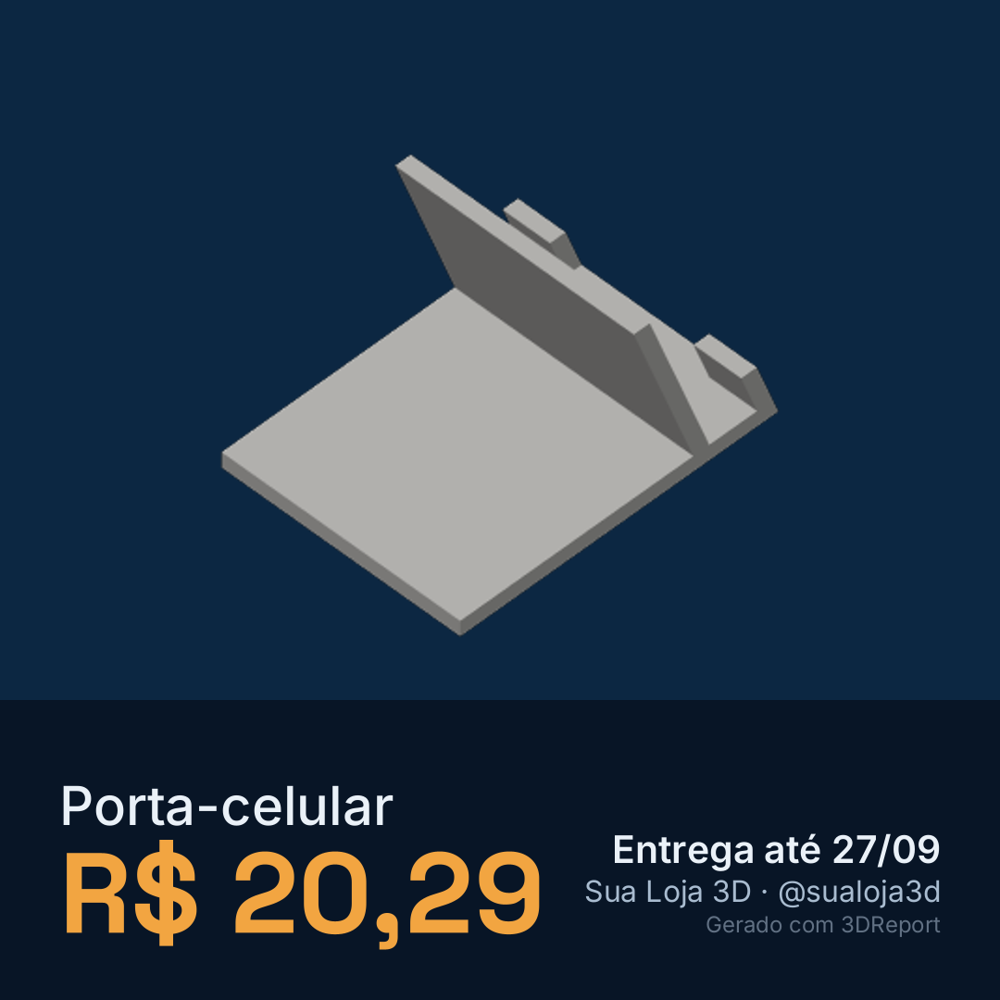

<p align="center">
  
</p>

<h1 align="center">3DReport</h1>

<p align="center">
  <a href="https://github.com/mateustoin/3DReport/releases/latest"></a>
  <a href="LICENSE"></a>
  
  
  <a href="https://github.com/mateustoin/3DReport/actions/workflows/ci.yml"></a>
  <a href="https://github.com/mateustoin/3DReport/actions/workflows/release.yml"></a>
  <a href="https://buymeacoffee.com/mateustoin"></a>
</p>

<p align="center">
  <a href="README.md">Português</a> ·
  <a href="https://mateustoin.github.io/3DReport/en/">Website</a> ·
  <a href="https://github.com/mateustoin/3DReport/releases/latest">Download</a> ·
  <a href="https://mateustoin.github.io/3DReport/en/calculadora.html">Online calculator</a> ·
  <a href="https://mateustoin.github.io/3DReport/en/manual.html">Quick manual</a>
</p>

**The system for people who sell 3D prints**: free, open source and 100% on
your computer. Drag in the G-code and your **3D printing quote** builds itself
from the real cost (filament, energy, machine, your own time, tax and the fee of
each sales channel); send it to the customer on WhatsApp or as a PDF with your
brand; negotiate without losing money; and follow every order to delivery. No
account and no monthly fee: your prices and your customers never leave your
machine.

## Contents

- [Features](#features)
- [Screenshots](#screenshots)
- [Support the project](#support-the-project)
- [Stack](#stack)
- [Quick start](#quick-start)
- [Installers](#installers)
- [Structure](#structure)
- [Documentation](#documentation)
- [Contributing](#contributing)
- [License](#license)

## Features

<details>
<summary>See the full list (30+ ready)</summary>

**Quote**
- Production cost and sale price calculation (`core`)
- Drag the G-code into the window and the quote builds itself: length, time, photo, print settings and, when the name matches what you saved, the printer and the filament (Bambu Studio, OrcaSlicer, PrusaSlicer, SuperSlicer, Cura)
- Multicolor parts (AMS, MMU): several filaments in the same print, each with its own meters and price; a multicolor G-code already fills in the usage of each extruder, with purge and tower
- Orders with several prints (a big part, a diorama, several plates in one delivery): each print is a card with its own printer, filaments, time and G-code, but the customer sees one item, one price and one delivery date
- Editing a saved order or product happens on the Quote tab itself (two columns), with no dialog, with an "Editing #0042" bar and "Cancel editing"
- Quote screen in two columns: the inputs on one side, the price, the breakdown and the negotiation on the other
- Quantity per quote, with a unit price and your working time entered for the whole order (a batch costs less per part)
- Negotiation: type the price agreed with the customer and see the profit, the margin and a loss warning, with the minimum price always in view, and see on the Dashboard how much discount you gave in the period
- Comparison between your printers: how much the same part costs on each machine
- Save a quote (name, photo and model link are optional)
- Optional services on the quote (painting, sanding, delivery and so on), with the amount typed on each order and charged per part or once per order; with the service time entered, the amount is suggested from your hourly rate and the profit shows what the service really earns
- Supplies in the cost (key ring, magnet, box, bag), per part or per order
- Sales channels with their own fee (Etsy, eBay, Amazon, card), chosen per quote, with a fixed fee per item and price tiers like the ones marketplaces use
- Tax on the sale and shipping as their own line, without folding them into the price of the part; free shipping for the customer coming out of your profit, with the price that would keep the margin
- Minimum order price and a rush fee ("Express delivery" for the customer)
- Clickable model link (opens in the browser) and part weight (internal use)

**Orders, Catalog & Dashboard**
- Orders (quote history) on their own screen: look up, filter, download the photo, delete; orders with more than one print show "N prints"
- Customer and order status per quote
- Catalog on its own screen, apart from the orders: keep parts with a price and no customer (for people just starting or building a storefront), outside the Kanban and the Dashboard, and create the order with one click on "Sell"
- A Dashboard that shows the catalog and which part is worth offering first while there are no sales yet
- A living catalog: a warning when costs changed and the product price needs updating, a round advertised price ($18.90) instead of the calculated one, and categories that split the PDF catalog into sections
- Export as a PDF or copy and paste (name + sale value + photo in the PDF)
- Open the WhatsApp chat with the quote already written, and make a square image of the part for a chat or a story
- Delivery date on the quote, standing out in the PDF, the message and the image, with a warning in Orders when the date passes
- Deposit and payments recorded per order (Orders shows whether it is paid, has a deposit or is partly paid) and a PDF receipt for each payment
- Ready-made messages per stage (approved, printing, ready, out for delivery, payment reminder), editable, with a warning for a quote that has been waiting, a tracking code and internal notes on the order
- Export several selected quotes in a single PDF (one per page)
- Catalog or portfolio exportable as a PDF (grid, several parts per page)
- Dashboard: what sold in the period (a quote only counts when the customer approves it), how much each machine hour and work hour earned, the parts that make the most profit and the customers who ask for the most discount
- Pix for sellers in Brazil: a Pix code and QR in the PDF and the WhatsApp message, shown only when the default currency is the real

**Catalogs**
- Filament list: brand, material type (with a suggested density), several colors and manual stock control per color
- Printer list: saved profiles (energy use, maintenance, investment), with a pre-filled catalog of the main brands to pick from
- Maintenance per printer: each component with its own interval in hours (change the nozzle, lubricate the rails), a warning when it is close or overdue, a journal of what was done and hours of use outside quotes (calibration, reprints)
- Supplies list, with the cost of each unit
- Optional stock in grams per color and in units per supply, deducted automatically when an order is Ready, with ad hoc use (failures, tests), "I weighed the spool", low-stock and shortage warnings on the quote, purchases with shipping that update the price (only if you confirm) and a shopping list
- Import and export filaments as a file, to share your list
- Archive a filament, printer, service, supply or sales channel that is in use: it disappears from the choices on a new quote without deleting anything, and old orders and products keep calculating normally

**PDF customization**
- Your brand on the PDF: logo and contact (WhatsApp, email, Instagram) in the header, an optional border, a watermark and a footer with the name
- Automatic chat image background: a dark part comes out on a light background so it does not vanish, and you can force a dark or light background in Settings ("Image background")
- A discreet "Made with 3DReport" line in the corner of the PDF (with a link to the site) and of the chat image
- PDF preview in Settings ("See how it looks"), even before saving
- Templates: saved snapshots of the PDF look (watermark, footer, border, print time), with an indicator of the active template; logo and contact stay out, so they are not lost when you switch templates. Loading a template fills in the fields and you confirm with "Save"

**Settings & platform**
- A sidebar with the screens grouped (Sales, Setup, Settings and About); below a certain window width it becomes an icons-only rail with a tooltip on hover
- Settings in sections (Business, Sales channels, Customer documents, Appearance, Backup), with a single "Unsaved changes" bar instead of several "Save" buttons scattered around
- Backup and restore of your data in a `.zip` file (take it to another computer, recover after a reformat)
- Multiple currencies (BRL, USD, EUR, GBP), with the right decimal and thousands separators
- Light and dark theme (follows the system by default)
- The app in Portuguese and English: the language follows the system by default and can be changed in Settings, at once; the PDF, message, image and receipt come out in the chosen language
- Keyboard shortcuts: `Ctrl`/`Cmd` + `1` to `9` jump straight to each sidebar screen (Quote, Orders, Catalog, Dashboard, Filaments, Printers, Services, Supplies, Stock), `Ctrl`/`Cmd` + comma opens Settings, besides save and clear quote
- Confirmation before deleting (filaments, printers, services, orders)
- The window remembers its size, position and whether it was maximized, and opens that way again (if it still fits on the screen)
- Optional new-version check: off by default; when on, the only thing that leaves your machine when the app opens is a request to GitHub's public releases page, to warn you if there is a newer version
- Persistence on disk (`~/.3dreport/`, JSON files + photos). Version 2.0 changed the data format: on opening, the 1.x data is kept in `~/.3dreport-v1`, with no conversion and nothing deleted
- App version and the About screen (author, GitHub, donation and a summary of each screen)

</details>

## Screenshots

<p align="center">
  
  
  
  
  
  
</p>

The screenshots come from the app itself, with sample data (see [development.md](docs/development.md#prints-do-site), in Portuguese).
Ready-made texts, facts and images for anyone who wants to write about the project are on the
[press page](https://mateustoin.github.io/3DReport/en/imprensa.html).

## Support the project

3DReport is and always will be free and open source: there is no paid edition
and no subscription. If it helps you, please consider a voluntary donation:
[Buy Me a Coffee](https://buymeacoffee.com/mateustoin).

## Stack

- Kotlin 2.4.20 · Kotlin Multiplatform
- Compose Multiplatform 1.12.0 · Material 3
- Gradle 9.7.1 (wrapper) · JDK 21
- Platform: desktop (Windows/Linux/macOS). Android planned.

## Quick start

```bash
./gradlew :composeApp:run   # runs the desktop app
./gradlew allTests          # runs the tests
./gradlew build             # builds and tests everything
```

Prerequisite: JDK 21. Recommended IDE: Android Studio or IntelliJ IDEA (VS Code
works through the terminal). Details in [docs/development.md](docs/development.md) (in Portuguese).

## Installers

Native installers (`.deb`/`.msi`/`.dmg`) are built by CI on each release and
published on [GitHub Releases](https://github.com/mateustoin/3DReport/releases).
Because they are not digitally signed (a recurring cost that does not fit a
100% free, donation-based model), Windows may warn "Unknown publisher" (click
"More info", then "Run anyway") and macOS may block opening the first time:
try right-click, then "Open"; if that does not work (common on recent macOS
versions), go to System Settings, then Privacy & Security, and click "Open
Anyway" on the notice about the blocked app.

## Structure

```
core/        Domain and calculation engine (pure Kotlin Multiplatform, no UI)
composeApp/  Compose Multiplatform interface (desktop)
web/         The site's calculator: the core compiled to JavaScript
docs/        Documentation
site/        Project website (GitHub Pages)
```

## Documentation

The project documents in `docs/` are in Portuguese.

| Document | Content |
|---|---|
| [CHANGELOG.md](CHANGELOG.md) | What changed in each version (each version ends with an "In English" summary) |
| [docs/development.md](docs/development.md) | Setup, IDE, run, test, package |
| [docs/architecture.md](docs/architecture.md) | Modules, platforms, conventions |
| [docs/pricing-formulas.md](docs/pricing-formulas.md) | Calculation parameters and formulas |
| [docs/decisions.md](docs/decisions.md) | Index of the approved decisions; the text of each one lives in `docs/decisions/` |
| [docs/roadmap.md](docs/roadmap.md) | Backlog of improvements and next implementations; the history and the catalog by topic live in `docs/roadmap/` |
| [CLAUDE.md](CLAUDE.md) | A short guide for people developing with an AI assistant: commands, rules and where to read each thing |
| [docs/pesquisa-de-mercado-2026-09.md](docs/pesquisa-de-mercado-2026-09.md) | Market research from Sep 2026: competitors, what the app lacks and what would need the cloud (in Portuguese) |
| [core/README.md](core/README.md) | `core` module |
| [composeApp/README.md](composeApp/README.md) | `composeApp` module |
| [CONTRIBUTING.md](CONTRIBUTING.md) | How to propose changes and send a PR |

## Contributing

Contributions are welcome. See [CONTRIBUTING.md](CONTRIBUTING.md) for the
setup, testing and PR workflow.

## License

Open source under the [Apache License 2.0](LICENSE). Free, with no paid
edition. See [Support the project](#support-the-project).

The interface icons come from Material Symbols (Google, Apache 2.0); details in
[THIRD-PARTY-NOTICES.md](THIRD-PARTY-NOTICES.md).
